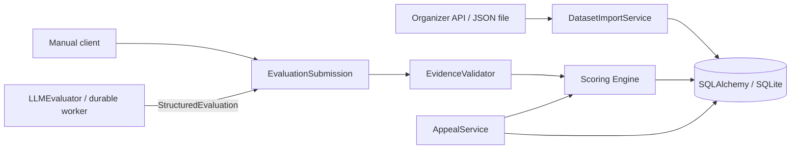

# Архитектура Stage 1

## Границы компонентов

`api/` принимает запросы и возвращает Pydantic schemas. `services/` реализует операции, `models/` — сохранение и ограничения. Отдельный repository слой пока не добавлен: SQLAlchemy Session достаточен, а бизнес-операции уже изолированы от маршрутов.

- `DatasetImportService`: доверенный HTTP endpoint из Settings, ограниченный по размеру ответ, валидация envelope, атомарное сохранение и дедупликация.
- `ChecklistService`: создание чек-листа, полные снимки версий, проверка суммы весов при активации/оценке.
- `ScoringEngine`: чистая функция над конфигурацией/ответами, без HTTP, БД, LLM и специальных правил по коду критерия.
- `EvidenceValidator`: принадлежность сообщений диалогу, порядок диапазона, наличие точной цитаты.
- `EvaluationService`: единый конвейер проверки/расчёта/сохранения manual, test и будущих ai результатов. HTTP endpoint пока разрешает только manual/test.
- `AppealService`: одна открытая апелляция на результат критерия, неизменяемое решение, пересчёт текущего состояния по цепочке решений.

## Данные и инварианты

`Dataset.group_id` уникален. У диалога уникальна пара `(dataset_id, conversation_id)`. Это намеренно допускает одинаковый внешний идентификатор в DEV и контрольном наборе. Внутренний целочисленный `Conversation.id` используется во всех FK и REST detail URL. Исходный `conversation_id` — внешний текстовый идентификатор для поиска.

`content_hash` вычисляется по валидированной записи; одинаковая повторная запись не меняется, изменённая вызывает `409` и откат всего пакета. Порядок сообщения задаёт уникальный `(conversation_id, message_index)`, индекс начинается с 0. Timestamp сохраняется строкой без нормализации. Для чата валидируется MM:SS (минуты могут быть длиннее двух цифр), для звонка — ISO 8601 с timezone. URL аудио сохраняется и никогда не запрашивается backend.

Dataset — снимок накопленного импорта группы. `source` и `imported_at` описывают первое успешное создание; `total_records` — текущее число сохранённых диалогов. История попыток импорта не выделена в отдельную таблицу: неуспешные попытки не оставляют частичных записей, ошибка возвращается вызывающему клиенту, сетевые сбои отражаются в логах.

ChecklistVersion и Criterion — неизменяемая полная конфигурация. `version_number` уникален в чек-листе, коды и порядок критериев уникальны в версии. `status=published` означает сохранённый снимок; активность определяется только `Checklist.active_version_id`. Снимок с суммой весов !=100 допустимо сохранить для дальнейшей работы, но активировать и оценивать по нему нельзя. Изменения вносятся следующей версией. Создание нового Checklist сразу активирует его первую версию, поэтому она обязана иметь сумму 100.

Evaluation хранит исходный/текущий итог, исходный/текущий флаг грубых нарушений и исходную версию чек-листа. CriterionResult и Evidence не перезаписываются. Текущие ответы восстанавливаются из исходных результатов и упорядоченных AppealDecision. В API `answer`, `weighted_score`, `is_na` — исходные значения, `current_*` — значения после пересмотров.

Appeal хранит комментарий, критерий и статус pending/upheld/revised. Уникальный nullable `pending_result_id` запрещает две открытые апелляции на один результат и освобождается при решении. Закрытую апелляцию нельзя решить повторно. Новая апелляция после закрытия разрешена; её решение сравнивается с текущим ответом, сохраняя прежнюю историю. AppealDecision хранит до/после ответа, взвешенных баллов критерия, общего итога и обязательную причину.

## Транзакции и целостность

Все операции запроса используют одну транзакцию. Dependency Session завершается до отправки HTTP-ответа (`scope="function"`); конфликт commit не превращается в ложный `201`. Foreign keys включены на каждом SQLite-соединении. Unique constraints закрывают гонки импорта, номеров версий, открытых апелляций и повторных решений.

Evaluation и Checklist используют SQLAlchemy optimistic versioning. Решения по разным критериям одной оценки обновляют revision, предотвращая потерю параллельного изменения. SQLite lock/busy даёт безопасный `503`, нарушение уникальности или устаревшая revision — `409`. Автоматического повтора мутации нет. ORM-защита запрещает изменение/удаление сохранённых снимков и исходных полей Evaluation. Межсущностные проверки evidence/принадлежности версии выполняют сервисы; доступ к записи через обход сервисов не является публичным контрактом.

UTC даты хранятся через UTCDateTime. Decimal хранится строкой через ExactDecimal: SQLite NUMERIC иначе может возвращать значения через float. Вся арифметика — Python Decimal; база не суммирует эти строки. Агрегации чисел для будущего Dashboard следует делать в сервисе или отдельной согласованной numeric-проекции.

## Миграции и переносимость

`619a995632a7` создаёт схему, `0002_default_checklist` добавляет замороженный снимок рубрики. Seed-миграция не импортирует изменяемую текущую бизнес-конфигурацию. Приложение не вызывает create_all и не выполняет миграции на каждом старте. Upgrade работает на чистой базе; downgrade — разрушительная операция для одноразовой dev-БД, не процедура обновления production.

FK, уникальность, JSON и сервисы используют SQLAlchemy, без SQLite-upsert в бизнес-логике. Особенности SQLite BEGIN/PRAGMA изолированы в `core/database.py`; циклический FK активной версии отдельно создаётся для диалектов с ALTER. PostgreSQL потребует драйвер, URL и отдельную проверку миграций, а не переписывание Scoring Engine.

## AI Stage 2

`AIEvaluator` — Protocol; реальная реализация — `LLMEvaluator`. Вход `EvaluationContext` включает детальный диалог с message IDs и VersionRead с условиями N/A/шкалами. Выход `StructuredEvaluation` содержит только ответы, объяснения и evidence. JSON Schema доступна через `model_json_schema()`.

Реальный pipeline: JobService закрепляет VersionRead → worker claim/lease → AIOrchestrator загружает DTO и закрывает read transaction → LLMEvaluator/PromptEngine/provider → grounding/semantic audit → EvaluationSubmission(source="ai") → EvaluationService → атомарный commit Evaluation + job. Scoring Engine не получает итоговые числа от LLM.

Новые таблицы: ai_jobs, ai_batches, ai_job_attempts, ai_worker_lease. Подробности и поведение при crash/cancel: [AI jobs](ai-jobs.md), [AI engine](ai-engine.md). Stage 1 snapshots и апелляции не менялись.
