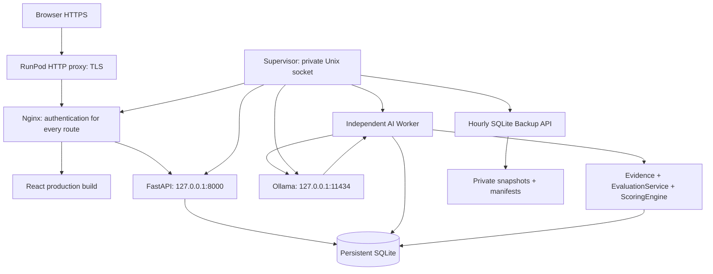

# Production architecture

Статус: конфигурация проверена локально; развёртывание на конкретном RunPod ожидает SSH.

Frontend и API — same-origin. AI requests быстро возвращают job ID; inference не удерживает HTTP-запрос и SQLite transaction. Worker использует существующие lease, retries, cancellation и idempotency. В production запускается один supervised API и один worker, concurrency модели задаётся конфигурацией. Scoring Engine не изменялся.

Release-код и build привязаны к одному Git SHA. Данные, секреты, модели и backup находятся вне release directory. Rollback кода не подразумевает downgrade или замену БД. Приёмка storage/lifecycle должна подтвердить сохранность состояния после Pod restart; локальный тест этого не доказывает.

Snapshot сохраняет все таблицы, включая job attempts и appeal decisions. Health отдельно проверяет API, provider, worker, реальную очередь и свободный диск. Backend/worker пишут безопасные события; proxy не пишет access logs.
