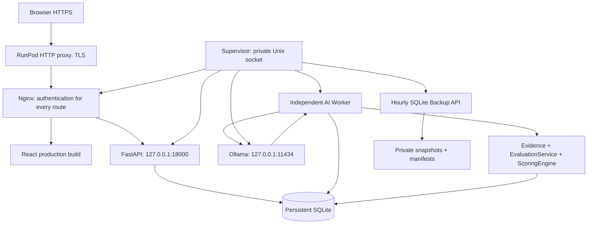

# Production architecture

Развёрнуто на существующем Pod `f05y0qgekhw7ag` 2026-11-08: RTX 4090 / 24564 MiB,
Ubuntu 24.04.5, network volume `te2bym73hq`, mount `/workspace`.
Публичный HTTPS: https://f05y0qgekhw7ag-8080.proxy.runpod.net — все маршруты требуют входа.

Frontend и API — same-origin. AI requests быстро возвращают job ID; inference не удерживает HTTP-запрос и SQLite transaction. Worker использует существующие lease, retries, cancellation и idempotency. В production запускается один supervised API и один worker, concurrency модели задаётся конфигурацией. Scoring Engine не изменялся.

Release-код и build привязаны к одному Git SHA в `/workspace/cqa/releases/`.
`config/runtime.json` указывает текущий checkout; данные, модели и backup находятся вне него.
Rollback кода не подразумевает downgrade или замену БД.

Приватный порт API изменён на 18000: штатный образ уже содержит proxy 8001 → 8000.
Использование 8000 могло бы обойти вход CQA. Существующий Jupyter:8888 сохранён,
его собственная аутентификация включена. Ollama доступна только на loopback:11434.

Network volume игнорирует chmod/chown: каталоги видны как 0777, файлы как 0666.
Поэтому plaintext secrets, Unix sockets и home сервисного пользователя находятся на
локальной POSIX ФС `/run/cqa` (0700/0600). На volume хранится только AES-256-GCM vault
с секретами. SQLite остаётся на приватном account-owned volume; её защитой служит
изоляция volume провайдером, а не неработающие Unix permissions. Шифрование самой БД
этой схемой не заявляется. Подтверждены cross-process SQLite locks и 40 конкурентных
commits; используется DELETE journal, WAL на сетевой ФС не включён.

Supervisor работает независимо от SSH и восстанавливает дочерние процессы.
**Полный автозапуск после restart/redeploy Pod отложен пользователем.** Подготовлен
`deployment/bootstrap.sh`: восстановить секреты, запустить Supervisor, затем сохранить
штатный `/start.sh` с Jupyter/SSH. Для автоматического lifecycle ещё нужны Start Command
и защищённый `CQA_VAULT_KEY` в настройках Pod, затем реальный restart test.

Snapshot сохраняет все таблицы, включая job attempts и appeal decisions. Health отдельно проверяет API, provider, worker, реальную очередь и свободный диск. Backend/worker пишут безопасные события; proxy не пишет access logs.
